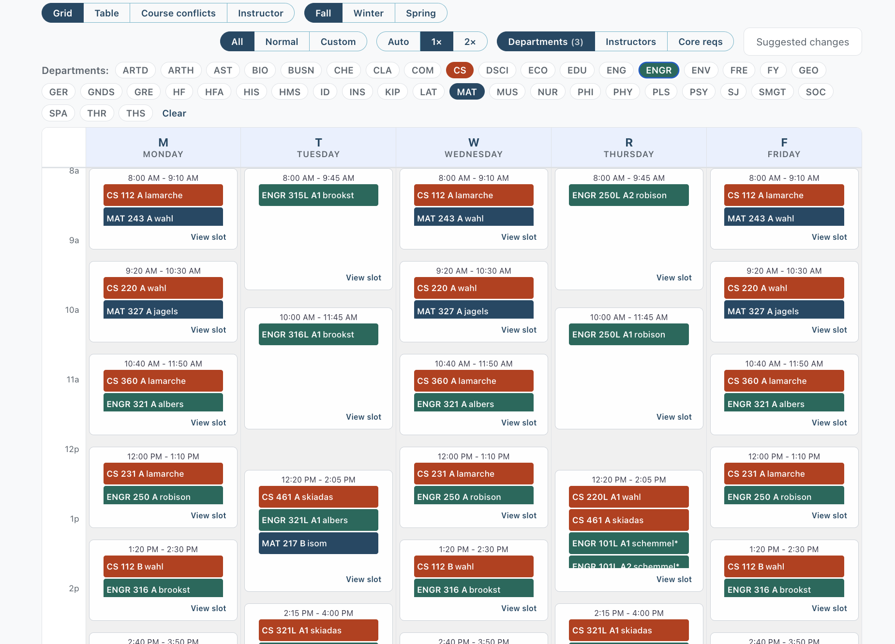

<!-- _class: lead -->

# Teaching CS in the age of AI

Haris Skiadas · 2026-10-23

<!--
Speaker notes live in HTML comments. In the browser press `p` for presenter view.
These notes are not published in the built HTML.
-->

---

# Me

- Programming since 6yo
- Pure math background
- Came to HC to teach Applied Stats
- Started helping out in CS
- Current focus on software development courses
- Write software for college (evals, elections, scheduler)

---

# Overview

- Traditional CS teaching
- AI writes the code
- The role of the software developer
- What/how to teach

---

# Making PB&J

Provide precise instructions for making a PB&J sandwich

---

# Key learning objectives

- Break problem into smaller pieces
- Provide precise steps
- Computers are very literal
- Beware of un-communicated assumptions

---

# Complexities in SD

- Essential complexities
  - Solve the right problem
  - Break problem into manageable pieces
  - Create correct abstractions
  - Verify, deploy, monitor
- Accidental complexities
  - Programming language syntax
  - Obscure compiler errors
  - Incompatible systems
  - Undocumented behavior

---

# My AI summer experiment

How far can I go without writing any code myself?

- LLM model: DeepSeek v4 flash
  - Text in, text out
- Agent: OpenCode
    - Uses an LLM model for the "thinking"
    - Provides general instructions (plan/build mode)
    - Sends user prompt and conversation history
    - Specifies allowed "tool calls"
    - Loop driven by model responses

---

# Example Agent interaction

- User: I would like more color contrast on this button.
- Agent to Model:
  - Here are rules to follow
  - user wants ....
  - You can use `webfetch`, `list`, `read`, `edit`, `run`
- Model reply: List files that end in `.css`
- Agent to model: here they are
- Model reply: Read file `buttons.css`
- Agent to model: Here it is
- Model reply: Web search for "color contrast rules"

---

- Agent reply: Here are webpage contents ...
- Model: I have two possible solutions, ask the user
- Agent to user: Here are two possibilities.
- User to agent: Let's go with the first one
- Agent to model: Here is the previous convo. User wants first option.
- Model to agent: Edit `buttons.css` with ...
- Agent: OK, done

---

- Model: Run build process
- Agent: Done, no errors
- Model: Run "playwright" script
- Agent: Here are the results (all pass)
- Model: Run `git commit` and `git push`
- Agent: Done, no errors
- Model to Agent: Report back to user
- Agent to user: Here is what I did. The website is updated

---

# Projects undertaken

- Math placement test
    - Understand the existing solution (WebWork, PG)
    - Research options for PG without WebWork
    - Create new website + database + renderer
    - Plan data migration
- Psych projects site
    - Understand PsychoJS + Pavlovia API
    - Implement Pavlovia equivalent

---

- Octave-in-browser (MatLab alternative)
  - Determine what packages can be ported to WebAssembly
  - Figure out how to make plotting work
  - Deploy suitable interface
- Registrar tools (scheduler, major planner, catalog)
  - Read and process catalog.hanover.edu
  - Identify course entry parts (requirements, prereqs)
  - Resolve inconsistencies
  - Codify trackable major requirements
  - Interface for faculty to visualize schedules

---

---

# Takeaways

- AI can write the code
- AI can test the code
- AI can deploy the program
- AI lacks "common sense" (bloated/inconsistent UI)
- AI needs specific goals
- AI is too literal
- AI forgets anything it wasn't trained on

---

# How AI is changing development

- Everyone can get a basic app going
- Can build simple apps quicker
- Apps that weren't worth building before now are
- Opportunities for savings/efficiency for HC

---

# AI and SD disciplines

...

---

# What about our CS classes

...
