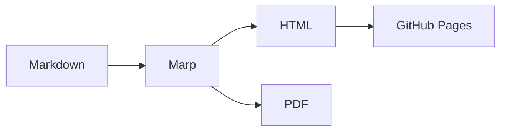

<!-- _class: lead -->

# Example Talk

### Markdown Slides with Marp

Haris Skiadas · 2026-01-15

<!--
Speaker notes live in HTML comments. In the browser press `p` for presenter view.
These notes are not published in the built HTML.
-->

---

# What this deck demonstrates

- One Markdown file per talk
- Shared theme across all talks
- Syntax-highlighted code
- Math via KaTeX
- Diagrams via Mermaid
- Local images from this talk's `assets/` folder

---

# Code

```python
def fibonacci(n: int) -> int:
    a, b = 0, 1
    for _ in range(n):
        a, b = b, a + b
    return a
```

Marp highlights this automatically — no plugins required.

---

# Math

Inline: $e^{i\pi} + 1 = 0$.

Block:

$$
\int_{-\infty}^{\infty} e^{-x^2}\,dx = \sqrt{\pi}
$$

---

# Diagram



---

# Local image


Images resolve relative to this deck because the build mirrors the
source tree into `dist/`.

---

# That's it

Add a new folder under `slides/` and push.
